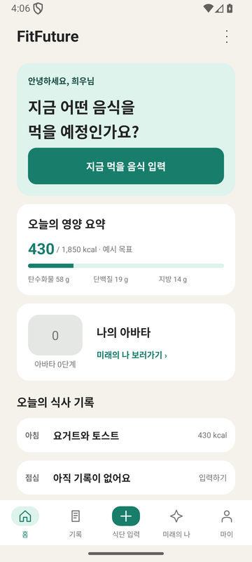
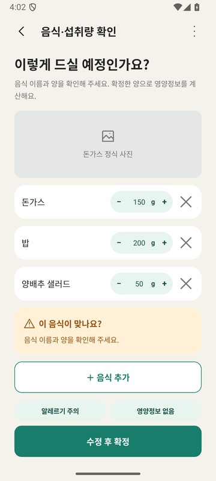
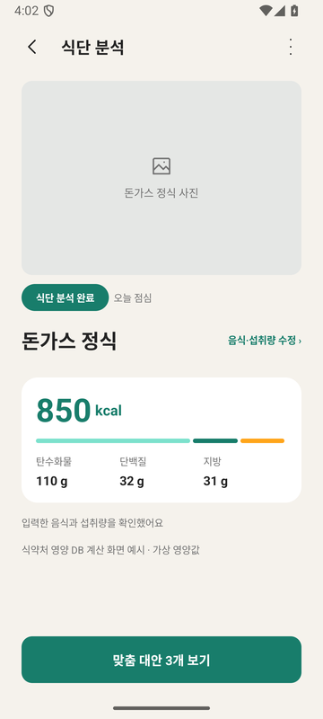
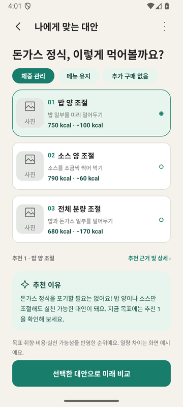
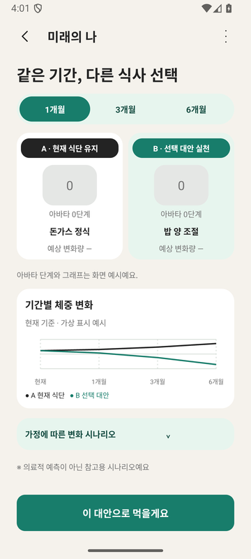
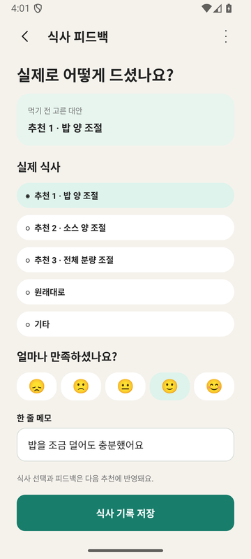

<div align="center">

# FitFuture

### 미래의 나를 위한 오늘의 한 끼

먹으려는 음식을 입력하고, 나에게 맞는 식사 방법을 고르고,<br>
그 선택이 이어질 미래의 변화를 비교해 보세요.

**음식 인식 · 맞춤 식단 추천 · 미래 아바타**

[앱 소개](#앱-소개) · [주요 기능](#주요-기능) · [앱 화면](#앱-화면) · [구현 범위](#구현-범위)

</div>

---

## 앱 소개

**“지금 이 음식을 먹어도 괜찮을까?”**

건강한 식사를 하고 싶지만, 매번 새로운 메뉴를 고르거나 좋아하는 음식을 포기하기는 어렵습니다. FitFuture는 대학생이 자신의 목표와 생활에 맞는 식사를 선택하고 꾸준히 이어갈 수 있도록 돕는 Android 식단 관리 앱입니다.

사진이나 음식 이름으로 한 끼를 입력하면 영양 정보를 확인하고, 목표·취향·예산을 고려한 대안 3개를 비교할 수 있습니다. 밥을 조금 덜거나 소스를 조절하는 것처럼, 지금 먹으려는 메뉴 안에서 실천할 수 있는 방법을 제안합니다.

선택한 식사 방법을 이어갔을 때의 변화는 미래 아바타와 그래프로 살펴봅니다. 식사 후에는 실제로 먹은 내용과 만족도를 남기며 나의 식습관을 돌아볼 수 있습니다.

## 주요 기능

### 01. 한 끼를 이해하는 음식 인식

사진을 촬영하거나 갤러리에서 선택하고, 음식 이름을 직접 입력할 수도 있습니다. 인식된 음식의 종류와 섭취량을 확인·수정한 뒤 열량과 탄수화물·단백질·지방 정보를 살펴봅니다.

### 02. 내 생활에 맞는 대안 3개

체중 관리 목표부터 음식 취향, 알레르기, 한 끼 예산까지 고려합니다. 원래 식단과 대안의 차이를 비교하고, 추천 이유를 확인한 뒤 자신에게 맞는 방법을 선택합니다.

> 돈가스 정식을 먹는다면? **밥 양 조절 · 소스 양 조절 · 전체 분량 조절**처럼 실천 가능한 선택을 비교합니다.

### 03. 같은 기간, 다른 식사 선택

현재 식단을 유지하는 경우와 선택한 대안을 실천하는 경우를 **1개월·3개월·6개월** 기준으로 비교합니다. 5단계 아바타와 변화 그래프로 장기적인 식사 선택을 생각해 볼 수 있습니다.

### 04. 실제 선택을 남기는 식사 기록

계획한 대안과 실제로 먹은 식사는 다를 수 있습니다. 실제 선택에 만족도와 한 줄 메모를 더해 기록하고, 날짜별 식사 내역과 체중 기록을 함께 확인합니다.

## 앱 화면

| 홈 | 음식·섭취량 확인 | 영양 분석 |
| :---: | :---: | :---: |
|  |  |  |

| 맞춤 식단 추천 | 미래 아바타 비교 | 식사 피드백 |
| :---: | :---: | :---: |
|  |  |  |

## 이용 흐름

| 단계 | 할 수 있는 일 |
| --- | --- |
| **나를 알려주기** | 기본 정보, 목표, 취향·알레르기, 예산·식사 환경 설정 |
| **먹을 음식 입력하기** | 사진 촬영, 갤러리 선택 또는 음식 이름 입력 |
| **한 끼 확인하기** | 음식과 양을 수정하고 영양 정보 확인 |
| **대안 고르기** | 추천 3개의 실천 방법과 원래 식단의 차이 비교 |
| **미래 살펴보기** | 선택한 대안의 1·3·6개월 변화 시나리오 확인 |
| **식사 기록 남기기** | 실제 선택, 만족도, 메모를 저장하고 다시 확인 |

## 구현 범위

현재 버전은 앱 화면과 식사 선택 흐름을 체험할 수 있는 프로토타입입니다.

| 구분 | 현재 제공하는 기능 |
| --- | --- |
| 프로필 | 기본 정보·목표·취향·알레르기·예산 설정 및 수정 |
| 음식 입력 | 카메라·갤러리·텍스트 입력과 선택 사진 표시 |
| 음식 확인 | 음식 이름·섭취량 수정, 항목 추가·삭제 |
| 영양·추천 | 예시 영양 정보와 대안 3개, 대안별 상세 비교 |
| 미래 비교 | 대안 선택, 1·3·6개월 탭, 5단계 아바타 표시와 그래프 |
| 기록·피드백 | 아침·점심·저녁 식사 기록, 실제 선택·만족도·메모 저장·조회·삭제 |
| 마이페이지 | 프로필 관리, 체중 기록, 아바타 변화 확인 |

사진 입력과 기기 내 기록 저장은 실제로 동작합니다. **AI 음식 인식, 영양 데이터, 추천 결과, 미래 변화 계산은 현재 예시 데이터로 제공하며 실제 서비스 연동을 준비하고 있습니다.** 아바타는 단계별 임시 이미지로 표시하고, 사진 기반 캐릭터 생성·알림·로그인은 향후 확장 항목입니다.

미래 변화는 가정에 따른 참고용 시나리오이며 의료적 예측이 아닙니다.

## 프로젝트 구성

```text
FitFuture/
├── app/                 # Android 앱
│   └── src/main/
│       ├── java/        # 화면·음식 인식·추천·미래 비교
│       └── res/         # 화면 레이아웃·아이콘·스타일
├── docs/
│   └── screenshots/     # 앱 화면
└── README.md
```

## 앱 실행

Android Studio에서 저장소를 열고 Gradle Sync 후 `app`을 실행합니다. Android 8.0(API 26) 이상을 지원하며 Android SDK 36이 필요합니다. 현재 버전은 별도 서버나 API 키 없이 체험할 수 있습니다.

## 디자인

[FitFuture · Android UI/UX](https://www.figma.com/design/nH07Tpn2zMYwRX8ZSBOo3Z/FitFuture-%C2%B7-Android-UI-UX?node-id=3-3)
