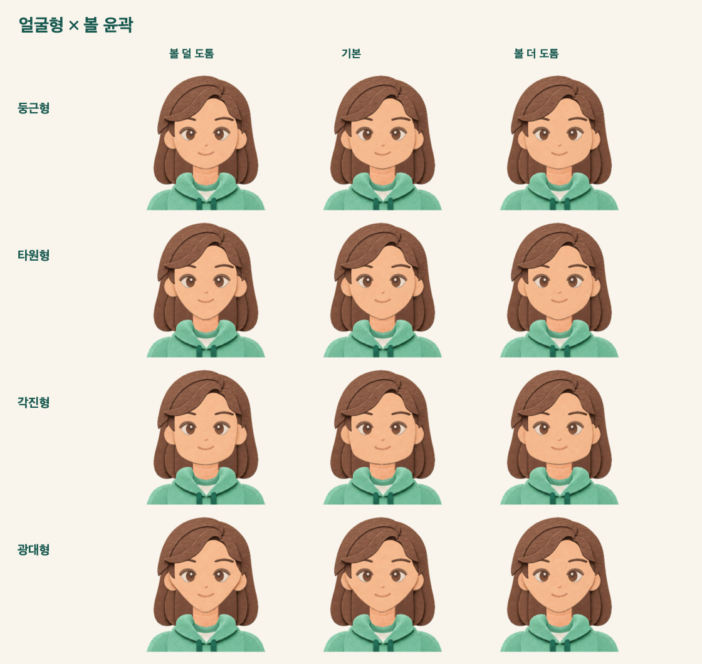
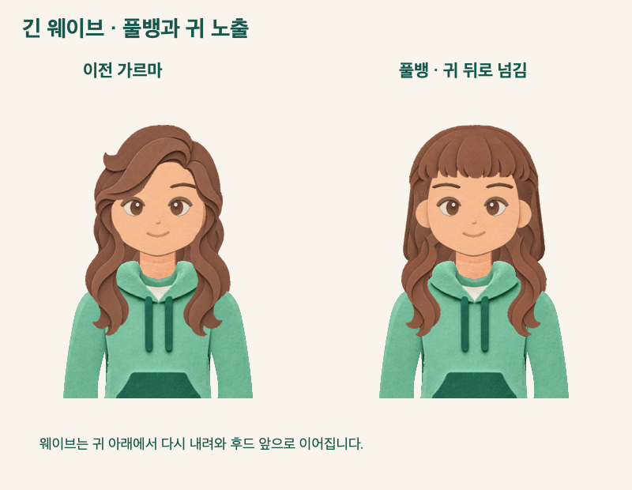
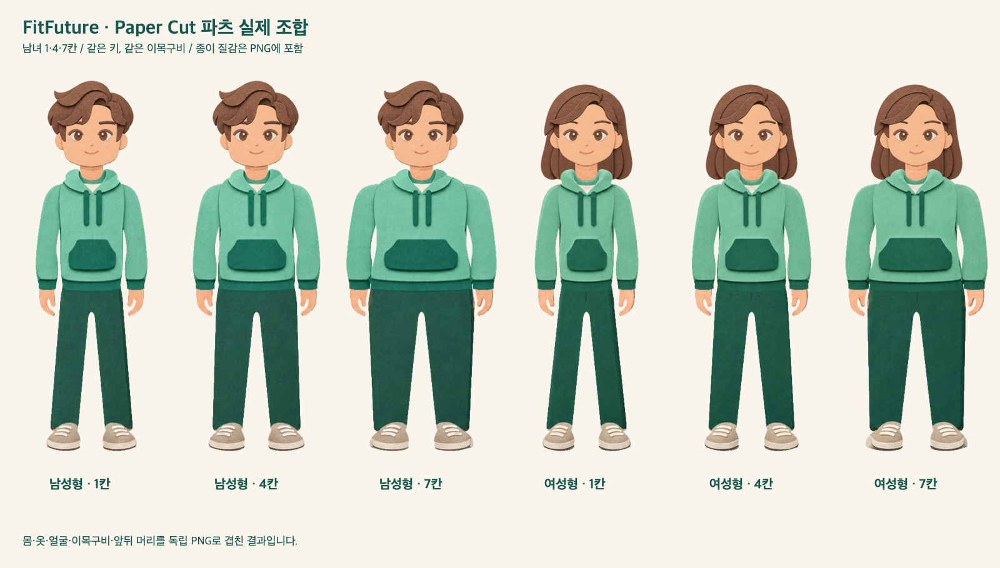

# FitFuture 아바타 파츠 사용과 인계 가이드

기준일 2026년 11월 17일  
대상 그림 패키지 Paper Cut v4  
대상 코드 Android Java 아바타 모듈과 데모 앱

FitFuture 아바타는 미리 만든 투명 PNG를 겹쳐 그리는 2D 캐릭터다. 사용자가 얼굴형·눈·머리 등을 고르면 파츠 ID를 저장하고, 키·체중과 변화 시나리오를 이용해 몸과 볼 윤곽에 사용할 PNG를 정한다.

**얼굴형마다 있는 3개는 서로 다른 얼굴형이 아니다. 같은 얼굴형의 볼과 턱 윤곽을 갸름·기본·도톰으로 나눈 체중 변화 표현용 그림이다.** 얼굴형은 유지하고 필요한 때 볼 윤곽만 교체한다.

파츠는 눈·얼굴·몸 같은 부위 그림이고, ID는 그 부위를 고르는 이름(`round`, `f10` 등)이다. 레이어는 그림을 겹치는 한 층을 뜻한다.

앱이 실행될 때 ImageGen을 호출하거나 그림을 새로 생성하지 않는다. ImageGen은 파츠 제작에 사용했고, 앱은 완성된 PNG를 조합한다.

## 1 처음 받았을 때

### 어떤 파일을 받아야 하나

| 전달 파일 | 내용 | 필요한 사람 |
|---|---|---|
| `FitFutureAvatar_v4_인계용.zip` | Android 소스, 아바타 모듈, 앱용 PNG 127개, 이 가이드 | 앱 개발자, 데모 실행 담당 |
| `FitFuture_PaperCut_v4_인계용.zip` | 파츠 원본, 앱용 PNG, ImageGen 시트와 수정 원본, 분리 코드, manifest, 이 가이드 | 디자이너, 파츠 수정 담당 |
| `아바타_사용_및_인계_가이드.md` | 두 패키지를 설명하는 기준 문서 | 모든 인계 대상자 |

ZIP은 소스와 그림 묶음이며 설치용 APK가 아니다. APK는 Android 빌드 환경에서 만들어야 한다.

두 ZIP을 같은 전달 폴더에 풀면 다음 구조가 된다.

```text
전달 폴더/
├── FitFutureAvatar/                 ← CODE_ROOT
│   ├── app/
│   ├── avatar/
│   ├── README.md
│   ├── AVATAR_GUIDE.md
│   └── guide-images/
└── FitFuture_PaperCut_v2/            ← PARTS_ROOT
    ├── app/
    ├── native/
    ├── revisions/
    ├── manifest.json
    ├── AVATAR_GUIDE.md
    └── guide-images/
```

이하 `CODE_ROOT`는 `FitFutureAvatar`, `PARTS_ROOT`는 `FitFuture_PaperCut_v2`를 뜻한다. 실제 경로에 맞춰 읽으면 된다.

**원본 폴더 이름의 v2는 제작 초기에 정한 경로다. 현재 그림 버전은 `manifest.json`의 `version: 4`다.** 이 폴더 이름만 보고 이전 그림으로 판단하지 않는다.

### 역할별 시작 순서

| 담당 | 먼저 할 일 | 이어서 볼 내용 |
|---|---|---|
| 처음 보는 팀원 | 2장의 구현 범위와 3장의 얼굴 3단계 개념 확인 | 4장 파츠 목록, 5장 조합 방식 |
| 앱 개발자 | 7장의 모듈 연결과 최소 예제 실행 | 8장 미래 비교, 9장 저장, 14장 검사 |
| 디자이너 | 3장 비교 그림과 10장 제작 기준 확인 | 11장 파츠 수정과 재생성 |
| 인계 담당 | 두 ZIP과 가이드 준비 | 15장 전달 체크리스트 |

## 2 현재 되는 일과 남은 일

| 기능 | 현재 상태 |
|---|---|
| 남성형·여성형 몸 선택 | 구현됨. 몸과 옷만 기본형별로 분리 |
| 키·체중으로 현재 체형 초안 선택 | 구현됨. BMI 설정값으로 7칸 중 하나 선택 |
| 사용자가 현재 체형 칸 수정 | 구현됨. 자동 또는 1~7칸 직접 선택 |
| 얼굴형·눈·눈썹·코·입·앞뒤 머리·상의·안경 선택 | 구현됨 |
| 눈 크기·눈썹 두께·코 크기·입술 두께 선택 | 구현됨. 각각 다른 PNG ID를 선택 |
| 앞머리 선택에 맞춰 뒷머리 함께 선택 | 구현됨. 이후 뒷머리만 바꿀 수도 있음 |
| 현재 아바타 구성 저장·복원 | 구현됨. SharedPreferences와 JSON 변환 |
| A/B 및 1·3·6개월 체형 비교 | 데모 코드에 구현됨 |
| 체형 변화에 따른 얼굴 볼 윤곽 교체 | 구현됨. 실제로 2칸 이동할 때만 교체 |
| 현재 얼굴의 볼 단계를 직접 선택하고 저장 | 아직 없음. 현재 편집 미리보기는 `base` 사용 |
| 사진 업로드와 얼굴 분석에 따른 파츠 자동 추천 | 아직 없음 |
| 피부색·머리색 변경 | 아직 없음. 저장 필드는 있으나 렌더링에 적용하지 않음 |
| 목표 체중 달성률과 진행 막대 | 현재 데모에 없음 |
| 바지·신발을 각각 선택 | 현재 없음. 몸 PNG에 함께 들어 있음 |
| Firestore·서버 저장 | 현재 없음. JSON 변환 함수만 제공 |
| Android 정식 빌드와 실기기 실행 확인 | 아직 완료하지 못함. 인수 환경에서 확인 필요 |

현재 편집 화면은 카테고리별 드롭다운으로 구성된 데모다. 최종 제품의 부위 탭·선택 버튼 디자인은 별도로 붙이면 된다.

사진 자동 추천을 나중에 추가하더라도 출력은 현재 카탈로그의 파츠 ID가 된다. 사진 분석이 `AvatarSpec`의 초안을 만들고, 사용자가 편집 후 확정하는 흐름으로 연결하면 된다. 현재 코드에 사진 분석 모델이나 추천 임계치는 들어 있지 않다.

## 3 얼굴형과 볼 윤곽의 구분

### 얼굴형은 정체성 선택이고 볼 윤곽은 변화 상태다

| 구분 | 예 | 언제 바꾸나 |
|---|---|---|
| 얼굴형 `face` | `round`, `v`, `square`, `heart` | 사용자가 자신과 비슷한 기본 얼굴형을 선택할 때 |
| 볼 윤곽 `cheekLevel` | `slim`, `base`, `full` | 같은 얼굴형에서 체형 변화에 따른 포동함을 표현할 때 |

예를 들어 둥근형을 선택한 사람은 아래 세 그림을 사용한다.

```text
face_round_slim.png   ← 같은 둥근형의 갸름한 볼 윤곽
face_round_base.png   ← 같은 둥근형의 기본 볼 윤곽
face_round_full.png   ← 같은 둥근형의 도톰한 볼 윤곽
```

살이 찌는 장면에서 `round`를 `square`로 바꾸지 않는다. 눈 크기·코·입·머리·표정도 체중 변화만을 이유로 바꾸지 않는다.



### 파일 이름과 코드 값

| 볼 윤곽 | 파일 접미사 | 코드 상수 | 값 |
|---|---|---|---|
| 갸름 | `slim` | `BodyCellMapper.CHEEK_SLIM` | −1 |
| 기본 | `base` | `BodyCellMapper.CHEEK_BASE` | 0 |
| 도톰 | `full` | `BodyCellMapper.CHEEK_FULL` | +1 |

현재 데모는 편집 미리보기에 `base`를 사용한다. 미래 비교에서는 다음처럼 바뀐다.

| 현재 칸 | 의도한 이동 | 끝 칸 제한 후 실제 이동 | 미래 볼 윤곽 |
|---:|---:|---:|---|
| 4 | +2 | +2 → 6칸 | 같은 얼굴형의 `full` |
| 4 | −2 | −2 → 2칸 | 같은 얼굴형의 `slim` |
| 4 | +1 | +1 → 5칸 | `base` |
| 6 | +2 | +1 → 7칸 | `base` |
| 7 | +2 | 0 → 7칸 | `base` |
| 1 | −2 | 0 → 1칸 | `base` |

**의도한 이동이 아니라 실제로 이동한 칸 수가 기준이다.** 따라서 끝 칸에서 멈추면 볼 윤곽도 과장해서 바꾸지 않는다.

현재 구현은 BMI나 현재 몸 칸으로 현재 볼 단계를 자동 추정하지 않는다. 예를 들어 현재 몸이 7칸이어도 현재 편집 화면의 얼굴은 `base`다. BMI로 얼굴의 살을 정밀하게 복원하는 모델도 아니다. 볼 3단계는 이 프로젝트의 그림 표현 규칙이다.

### 현재 볼 단계 선택을 추가하려면

이 기능은 후속 구현이다. 단순히 얼굴형 선택지에 `round_full` 같은 값을 넣으면 안 된다. 현재 `FACE` 카테고리는 얼굴형 ID만 받는다.

현재 볼 단계를 직접 고르게 하려면 별도의 `currentCheekLevel`을 상태와 저장 형식에 추가해야 한다. 미래 볼은 다음 관계로 확장할 수 있다.

```text
볼 변화량 = 실제 이동이 +2이면 +1, −2이면 −1, 그 외 0
미래 볼 단계 = clamp(현재 볼 단계 + 볼 변화량, −1, +1)
```

현재 `BodyCellMapper.future(...).cheekLevel`은 기본 볼 0을 기준으로 정한 렌더링 값이다. 현재 볼 선택을 추가할 때는 편집 화면·미래 계산·저장/복원·테스트를 함께 바꿔야 한다.

## 4 전체 파츠 목록

앱용 PNG는 **127개**다. '없음'과 '자동'은 파일이 아니라 선택 상태다.

| 파츠 | PNG 수 | 구성 | 앱 상대 경로 |
|---|---:|---|---|
| 얼굴 바탕 | 12 | 얼굴형 4 × 볼 윤곽 3 | `head/face_{shape}_{slim,base,full}.png` |
| 눈 | 12 | 눈매 4 × 크기 3 | `head/eyes_{a,b,c,d}_{s,m,l}.png` |
| 눈썹 | 9 | 모양 3 × 두께 3 | `head/brows_01.png` ~ `brows_09.png` |
| 코 | 9 | 모양 3 × 크기 3 | `head/nose_01.png` ~ `nose_09.png` |
| 입 | 12 | 입술 9 + 표정 3 | `head/mouth_l01.png` ~ `l09`, `mouth_e01.png` ~ `e03` |
| 앞머리 | 10 | 헤어스타일별 앞 레이어 | `head/hair_f01.png` ~ `hair_f10.png` |
| 뒷머리 | 5 | 앞머리에 대응하는 뒤 레이어 | `head/hair_b01.png` ~ `hair_b05.png` |
| 안경 | 2 | 둥근형·사각형 | `head/acc_glasses_round.png`, `acc_glasses_square.png` |
| 몸·하의 | 14 | 남녀 기본형 × 체형 7칸 | `{male,female}/body_c1.png` ~ `body_c7.png` |
| 상의 | 42 | 기본형 2 × 체형 7 × 옷 3 | `{male,female}/outfit_{id}_c{1..7}.png` |
| 합계 | **127** | | |

표의 중괄호는 파일명 규칙을 설명하는 표기다. 실제로는 `head/eyes_b_m.png`처럼 하나의 파일명을 사용한다.

얼굴·이목구비·머리는 남녀 공통이다. 몸 PNG에는 목·손·바지·신발이 들어 있고, 몸통의 옷은 상의 PNG가 채운다.

### 얼굴형과 눈 ID

| 종류 | ID | 화면 이름 |
|---|---|---|
| 얼굴형 | `round` | 둥근형 |
| 얼굴형 | `v` | 타원형 |
| 얼굴형 | `square` | 각진형 |
| 얼굴형 | `heart` | 광대형 |
| 눈매 | `a` | 기본 눈 |
| 눈매 | `b` | 내려간 눈 |
| 눈매 | `c` | 둥근 눈 |
| 눈매 | `d` | 올라간 눈 |
| 눈 크기 | `s / m / l` | 작게 / 보통 / 크게 |

`v`와 `heart`는 기존 저장 데이터를 유지하기 위한 ID다. 영어 이름만 보고 V라인·하트형으로 다시 해석하지 않는다.

눈의 저장 ID는 `b_m`처럼 눈매와 크기를 합친다. 크기를 바꿀 때는 해당 PNG를 선택하고, 눈 그림만 임의로 늘리지 않는다.

### 눈썹과 코와 입 ID

| 범위 | 종류 | 범위 안의 순서 |
|---|---|---|
| 눈썹 `01~03` | 일자 | 가늘게 / 보통 / 굵게 |
| 눈썹 `04~06` | 아치 | 가늘게 / 보통 / 굵게 |
| 눈썹 `07~09` | 각진 | 가늘게 / 보통 / 굵게 |
| 코 `01~03` | 타원 코 | 작게 / 보통 / 크게 |
| 코 `04~06` | 둥근 코 | 작게 / 보통 / 크게 |
| 코 `07~09` | 넓은 콧볼 | 작게 / 보통 / 크게 |
| 입 `l01~l03` | 기본 입술 | 얇게 / 보통 / 도톰 |
| 입 `l04~l06` | 굴곡 입술 | 얇게 / 보통 / 도톰 |
| 입 `l07~l09` | 둥근 입술 | 얇게 / 보통 / 도톰 |
| 입 `e01 / e02 / e03` | 표정 | 일자 / 미소 / 활짝 |

입은 현재 12개 중 하나를 선택하는 카테고리다. 입술 PNG와 표정 PNG를 동시에 겹치는 구조는 아니다.

### 앞머리와 뒷머리 조합

| 앞머리 ID | 스타일 | 함께 선택되는 뒷머리 |
|---|---|---|
| `f01` | 짧은 크롭 | `none` |
| `f02` | 둥근 앞머리 | `none` |
| `f03` | 일자 앞머리 | `none` |
| `f04` | 웨이브 가르마 | `none` |
| `f05` | 단발 | `b01` |
| `f06` | 중단발 가르마 | `b02` |
| `f07` | 긴 생머리 | `b03` |
| `f08` | 낮은 포니테일 | `b04` |
| `f09` | 짧은 뽀글 파마 | `none` |
| `f10` | 풀뱅 긴 웨이브 | `b05` |

`f08` 앞머리에는 꼬리가 없다. 꼬리는 얼굴 뒤에 그리는 `b04`다. `f09`는 이전 묶은 가르마 자리를 대체한 파마다.

`f10` 앞 PNG는 풀뱅 윗부분과 귀 아래 웨이브가 떨어져 있다. 귀 높이에 빈 구간을 둔 것이 정상이다. 뒷머리 `b05`가 귀 뒤를 연결한다. 이 빈 구간을 앞머리로 채우면 귀가 다시 가려진다.



상의 ID는 `hoodie_mint`, `sweatshirt`, `shirt`다. 안경 ID는 `glasses_round`, `glasses_square`이고, 선택하지 않을 때는 `none`이다.

### 원본은 왜 130개인가

`native/`에는 앱이 쓰는 127개 외에 제작용 뒷머리 3개가 더 있다.

```text
extra/hair_back_short.png
extra/hair_back_parted.png
extra/hair_back_pony.png
```

이 3개는 현재 앱 카탈로그에서 직접 선택하는 파츠가 아니다. 별도의 `common/` 7개는 기존 Figma 얼굴 조합용 이미지다. 미리보기·검증 PNG와 원본 시트도 앱 파츠 수에 포함하지 않는다.

## 5 PNG 좌표와 레이어 순서

### 앱용과 Figma용의 차이

| 파일 묶음 | 캔버스 | 배치 방식 |
|---|---|---|
| `PARTS_ROOT/app/` | 모든 파일 320×790, 투명 | 모든 레이어를 (0,0)에 겹침 |
| `PARTS_ROOT/native/` 몸·옷 | 320×790 | 전신 (0,0) |
| `PARTS_ROOT/native/` 얼굴·이목구비·안경 | 220×240 | 전신 (50,18) |
| `PARTS_ROOT/native/` 앞·뒤 머리 | 220×304 | 전신 (50,18) |

**앱용 PNG에는 머리의 (50,18) 이동이 이미 들어 있다.** 앱에서 위치를 다시 더하지 않는다.

파츠가 작은 눈·코여도 앱용 파일은 320×790 전체 투명 캔버스다. PNG의 투명 여백을 자동으로 잘라내거나, 각 파츠를 각각 중앙 정렬하면 위치가 어긋난다.

### 아래에서 위로 그리는 순서

```text
1 뒷머리
2 몸·피부·바지·신발
3 상의
4 얼굴 바탕과 귀
5 눈
6 눈썹
7 코
8 입
9 앞머리와 앞 웨이브
10 안경
```

이 순서를 `AvatarLayers.paths(...)`가 만든다. 뒷머리나 안경이 `none`이면 해당 레이어를 생략한다.

얼굴이 뒷머리보다 나중에 그려져야 귀가 앞에 보인다. 앞머리의 귀 부분은 투명해야 한다. 포니테일 꼬리를 앞 레이어로 옮기면 귀를 덮을 수 있다.

### 한 아바타의 실제 파일 예

여성형·몸 4칸·둥근형·도톰한 볼·보통 내려간 눈·풀뱅 웨이브·민트 후드·안경 없음이라면 다음 9개를 순서대로 그린다.

```text
avatar/head/hair_b05.png
avatar/female/body_c4.png
avatar/female/outfit_hoodie_mint_c4.png
avatar/head/face_round_full.png
avatar/head/eyes_b_m.png
avatar/head/brows_05.png
avatar/head/nose_01.png
avatar/head/mouth_e02.png
avatar/head/hair_f10.png
```

`avatar/`는 Android `assets` 안의 폴더 이름이다. APK의 절대 경로를 만들 필요가 없다.

## 6 현재와 미래 체형 계산

### 현재 몸 칸

```text
BMI = 몸무게 kg / (키 m × 키 m)
현재 칸 = 사용자가 확정한 bodyCell이 있으면 그 값
          없으면 BMI로 정한 초안
```

| 칸 | 현재 설정의 BMI 범위 |
|---:|---|
| 1 | 18.5 미만 |
| 2 | 18.5 이상 20.5 미만 |
| 3 | 20.5 이상 23 미만 |
| 4 | 23 이상 25 미만 |
| 5 | 25 이상 27.5 미만 |
| 6 | 27.5 이상 30 미만 |
| 7 | 30 이상 |

두 몸 기본형은 같은 칸 경계를 사용하고, 각 기본형의 다른 그림을 불러온다.

경계값과 정확히 같으면 위 칸이다. 예를 들어 23.0은 4칸이다. 이 값들은 `BodyCellConfig.DEFAULT`의 앱 설정값이다.

`bodyCell=0`은 자동 초안 상태다. 1~7은 사용자가 확정한 현재 칸이다. 현재 데모에서는 7칸 중 어느 칸이든 직접 고를 수 있다.

### 미래 몸 칸

변화율은 현재 체중을 기준으로 계산한다.

```text
changeRate = (미래 체중 − 현재 체중) / 현재 체중
```

`+4.3%`는 `0.043`이다. 함수에 `4.3`을 넘기지 않는다.

| 변화율 r | 이동 |
|---|---:|
| r ≤ −0.05 | −2칸 |
| −0.05 < r ≤ −0.02 | −1칸 |
| −0.02 < r < +0.02 | 0칸 |
| +0.02 ≤ r < +0.05 | +1칸 |
| +0.05 ≤ r | +2칸 |

```text
미래 칸 = clamp(현재 칸 + 이동, 1, 7)
실제 이동 = 미래 칸 − 현재 칸
```

미래 칸을 구할 때는 `BodyCellMapper.future(...)`를 사용한다. 미래 체중으로 BMI 칸을 다시 계산하면 합의한 단계 이동 규칙과 다른 결과가 나온다.

1·3·6개월은 각각 같은 현재 칸과 현재 체중에서 계산한다. 1개월 결과 칸에 다시 3개월 이동을 더하는 식으로 누적하지 않는다.

### 160cm와 55kg의 예

BMI는 약 21.5이므로 자동 초안은 현재 3칸이다.

| 장면 | 가정한 체중 변화 | 이동 | 몸 PNG 칸 | 얼굴 접미사 |
|---|---|---:|---:|---|
| 현재 | — | — | 3 | `base` |
| A | +2.4kg, 약 +4.36% | +1 | 4 | `base` |
| B | −1.6kg, 약 −2.91% | −1 | 2 | `base` |
| 증가 예 | +5% | +2 | 5 | `full` |
| 감소 예 | −5% | −2 | 1 | `slim` |

위 체중은 파츠 선택 규칙을 설명하는 입력 예다. 얼굴형을 둥근형으로 골랐다면 마지막 두 줄도 각각 `face_round_full`과 `face_round_slim`을 쓴다.

### 키 표시와 체중 수치

키 140~200cm를 전신 표시 배율 0.80~1.00에 대응시킨다. 범위 밖 키는 양 끝 배율로 고정한다. 160cm의 배율은 약 0.867이다.

현재 구현은 전신을 같은 비율로 확대·축소한다. 개인의 다리 길이나 머리 대 몸 비율을 키만으로 복원하지는 않는다. 체형 폭은 칸별로 따로 만든 몸·옷 PNG가 표현한다.

A/B는 같은 크기·패딩의 View와 같은 키 배율을 사용해야 발 높이와 크기가 맞는다. 원본 그림의 발바닥 기준은 y=777이다.

그림이 끝 칸에 멈추거나 변화율이 작아도 `+2.4 kg` 같은 수치는 계속 표시한다. 목표 달성률을 추가할 때도 체형 칸 계산과 별도 값으로 관리한다.



## 7 Android 앱에 연결하기

### 데모 프로젝트부터 확인

1. 코드 ZIP을 풀고 Android Studio에서 `FitFutureAvatar` 폴더를 연다.
2. JDK 17, Android SDK 34, Gradle 8.7을 사용할 환경을 준비한다.
3. Gradle Sync 후 `app`을 API 24 이상 에뮬레이터나 기기에서 실행한다.
4. 프로필 입력, 파츠 선택, 저장, 1·3·6개월 A/B 변경을 확인한다.

현재 설정은 AGP 8.5.2, Java 17, compileSdk/targetSdk 34, minSdk 24다. 최초 Sync에는 의존성 다운로드가 필요하다.

패키지에는 `gradle-wrapper.properties`만 있고 `gradlew`, `gradlew.bat`, `gradle-wrapper.jar`는 없다. 따라서 ZIP을 푼 직후 `./gradlew`를 실행할 수는 없다. Android Studio에서 Gradle 8.7 사용 설정을 맞추거나, Gradle 8.7이 준비된 환경에서 실행한다.

이미 사용하는 본 프로젝트에 완전한 Gradle wrapper가 있다면 아래 모듈 연결 방법으로 붙인 뒤 그 프로젝트의 wrapper를 사용하면 된다.

### 기존 앱에 모듈 붙이기

`CODE_ROOT/avatar/`를 본 프로젝트의 `avatar/` 모듈로 복사한다. 기존 프로젝트 설정은 유지하면서 다음 항목을 추가한다.

`settings.gradle`:

```groovy
include ':avatar'
```

앱 모듈 `build.gradle`:

```groovy
dependencies {
    implementation project(':avatar')
}
```

다음 PNG 폴더 전체를 본 앱 모듈의 `src/main/assets/avatar/`로 복사한다.

```text
PARTS_ROOT/app/male/     → 앱모듈/src/main/assets/avatar/male/
PARTS_ROOT/app/female/   → 앱모듈/src/main/assets/avatar/female/
PARTS_ROOT/app/head/     → 앱모듈/src/main/assets/avatar/head/
```

코드 ZIP의 `app/src/main/assets/avatar/`에도 같은 127개 PNG가 들어 있다. 둘 중 하나의 최신 묶음을 사용하면 된다.

`avatar` 라이브러리 모듈만 복사하면 PNG는 따라오지 않는다. PNG는 호출하는 앱 모듈의 `assets`에 넣어야 한다.

### 최소 표시 예제

레이아웃에 넣는다.

```xml
<com.fitfuture.avatar.AvatarLayerView
    xmlns:android="http://schemas.android.com/apk/res/android"
    android:id="@+id/avatarView"
    android:layout_width="match_parent"
    android:layout_height="420dp" />
```

다음 코드는 Activity에서 `setContentView(...)` 뒤에 사용하는 예다.

```java
import com.fitfuture.avatar.AvatarLayerView;
import com.fitfuture.avatar.core.AvatarCatalog.Category;
import com.fitfuture.avatar.core.AvatarSpec;
import com.fitfuture.avatar.core.BodyCellConfig;
import com.fitfuture.avatar.core.BodyCellMapper;
import com.fitfuture.avatar.core.BodyPreset;

AvatarSpec spec = AvatarSpec.defaults(BodyPreset.FEMALE)
        .with(Category.FACE, "round")
        .with(Category.EYES, "b_m")
        .withHairStyle("f10");

double heightCm = 160.0;
double weightKg = 55.0;
// 본 앱 입력 계층에서 양수·유한값 검사를 마친 프로필을 사용한다.
BodyCellConfig config = BodyCellConfig.DEFAULT;
int currentCell = spec.currentCell(config, heightCm, weightKg);
double heightScale = config.heightScale(heightCm);

AvatarLayerView view = findViewById(R.id.avatarView);
view.setAvatar(spec, currentCell, BodyCellMapper.CHEEK_BASE, heightScale);
```

`AvatarSpec`의 `with...` 메서드는 새 객체를 반환한다. 반환값을 `spec`에 대입해야 선택이 바뀐다. 변경 후에는 현재 칸을 다시 계산하고 `setAvatar`를 호출해 화면을 갱신한다.

현재 몸 칸을 직접 확정하려면 `spec = spec.withBodyCell(4);`처럼 바꾼다. 자동으로 돌리려면 `withBodyCell(AvatarSpec.CELL_AUTO)`를 사용한다. 어느 경우든 아래처럼 계산과 표시를 다시 실행한다.

```java
currentCell = spec.currentCell(config, heightCm, weightKg);
view.setAvatar(spec, currentCell, BodyCellMapper.CHEEK_BASE, heightScale);
```

헤어스타일 선택에는 `withHairStyle("f10")`을 사용한다. `with(Category.HAIR, "f10")`은 앞머리만 바꾸므로 맞는 뒷머리까지 선택하지 않는다.

### 다른 플랫폼에서 쓰기

Android 모듈을 사용하지 않는 앱도 같은 PNG를 사용할 수 있다. 320×790의 공통 캔버스에서 5장에 정리한 순서로 앱용 PNG를 (0,0)에 겹친 뒤, 합성 전체를 같은 비율로 화면에 맞춘다.

개별 PNG를 내용물 크기로 잘라 각자 View에 맞추는 방식은 피한다. 같은 목적지 사각형에 모든 레이어를 그리는 것이 현재 렌더러의 방식이다.

## 8 미래 비교 화면 연결 예제

현재 편집과 미래 A/B에 같은 `AvatarSpec`을 사용한다. 옷과 몸은 같은 칸 번호의 PNG를 선택하고, 얼굴은 같은 얼굴형에서 볼 접미사만 바꾼다.

```java
double currentWeight = 55.0;
double futureWeightA = 57.4;
double futureWeightB = 53.4;

double rateA = (futureWeightA - currentWeight) / currentWeight;
double rateB = (futureWeightB - currentWeight) / currentWeight;

BodyCellMapper.Future fa = BodyCellMapper.future(currentCell, rateA);
BodyCellMapper.Future fb = BodyCellMapper.future(currentCell, rateB);

avatarA.setAvatar(spec, fa.cell, fa.cheekLevel, heightScale);
avatarB.setAvatar(spec, fb.cell, fb.cheekLevel, heightScale);
```

`avatarA`와 `avatarB`는 같은 크기의 `AvatarLayerView`다. 수치와 끝 칸 안내는 View 밖 TextView에 붙인다.

```java
import java.util.Locale;

kgA.setText(String.format(
        Locale.KOREA, "%+.1f kg", futureWeightA - currentWeight));
kgB.setText(String.format(
        Locale.KOREA, "%+.1f kg", futureWeightB - currentWeight));

if (fa.clamped()) {
    cellA.setText("끝 칸이라 그림은 여기서 멈춰요");
}
```

변화가 1칸이면 얼굴은 `base`여도 정상이다. 7칸에서 더 증가하는 시나리오도 숫자는 증가하지만 그림은 7칸에서 멈춘다.

미래 결과 `fa.cell`을 사용자가 확정한 현재 `spec.bodyCell`에 저장하지 않는다. 현재 상태와 예측 표시 상태를 분리한다.

### 체중 예측 코드는 어디까지 제공하나

`WeightSimulator`는 데모용 열량 시나리오 계산 코드다. 하루 섭취 열량과 활동량을 받아 1·3·6개월 `Point` 배열을 만든다. `Point.changeRate`를 `BodyCellMapper`에 넘기면 된다.

이 코드의 `minKg / maxKg`는 예상 변화량에 ±20% 폭을 붙인 값이다. 현재 체중 변화 자체를 ±20%로 제한하는 기능은 아니다. 실제 체중 예측을 검증한 서비스 모델로 취급하지 않는다.

본 앱에서 다른 예측 모델을 쓰더라도 `현재 체중`, `미래 체중` 또는 `changeRate`만 맞춰 주면 아바타 조합 부분은 재사용할 수 있다.

현재 데모의 경고는 B 섭취 열량이 계산상 BMR보다 낮을 때 표시하는 조건이다. 체형 1칸 도달에 대한 별도 경고나 목표 진행률 표시는 아직 구현되어 있지 않다.

## 9 선택한 아바타 저장과 복원

저장하는 것은 완성된 전신 PNG 한 장이 아니라 **사용자가 고른 ID와 현재 몸 칸**이다.

```java
import com.fitfuture.avatar.AvatarStore;

AvatarStore.save(this, spec);
AvatarSpec restored = AvatarStore.load(this, BodyPreset.FEMALE);
```

저장 구조의 예:

```json
{
  "version": 3,
  "bodyPreset": "female",
  "bodyCell": 0,
  "face": "round",
  "eyes": "b_m",
  "brows": "05",
  "nose": "01",
  "mouth": "e02",
  "hair": "f10",
  "hairBack": "b05",
  "outfit": "hoodie_mint",
  "accessory": "none",
  "skin": "original",
  "hairColor": "original"
}
```

| 항목 | 의미 |
|---|---|
| `version` | 현재 `AvatarStore` JSON 스키마 버전 3 |
| `bodyPreset` | `male` 또는 `female` |
| `bodyCell` | `0` 자동, `1~7` 직접 확정 |
| `face` | 얼굴형 ID만 저장. `round_full` 같은 파일 접미사 조합은 넣지 않음 |
| `hair / hairBack` | 앞·뒤 머리 ID를 모두 저장 |
| `skin / hairColor` | 예약 필드. 현재 렌더러에서는 원본 색 사용 |

복원한 뒤에는 프로필의 키·체중을 읽고 `restored.currentCell(...)`을 다시 계산해 `setAvatar(restored, ...)`를 호출한다. JSON을 읽기만 해서는 View가 자동으로 바뀌지 않는다.

키·몸무게·나이·활동량은 이 JSON에 없다. 본 앱의 프로필 저장소에서 관리한다. 현재 볼 단계와 미래 체형 결과도 이 JSON에 저장하지 않는다.

서버 연동에는 `AvatarStore.toJson(spec)`과 `AvatarStore.fromJson(json, fallbackPreset)`을 쓸 수 있다. Firestore나 API 통신 코드는 별도로 연결해야 하며, 프로젝트의 저장 계층에 맞는 JSON 또는 Map으로 변환한다.

필드가 없거나 카탈로그에 없는 ID는 기본값으로 보완된다. 현재 `fromJson`은 버전별 변환기를 갖춘 구조가 아니라 필드별 기본값을 적용하는 수준이다.

**그림 패키지 버전 4와 저장 JSON 버전 3은 서로 다른 버전이다.** 현재 JSON에는 그림 패키지 버전을 저장하지 않는다. 따라서 같은 `f10` 파일을 새 그림으로 교체하면 기존 저장 아바타도 새 외형으로 표시된다. 예전 외형을 그대로 보존해야 하는 서비스라면 그림 버전 관리도 추가해야 한다.

## 10 그림체와 편집 기준

Paper Cut은 색종이를 자르고 겹친 듯한 면의 두께, 미세한 종이 결, 부드러운 접촉 그림자가 보이는 스타일이다. 기준 그림은 패키지 안의 다음 파일이다.

- `기본_남녀_조합.png`: 전신 비율과 기본 복장
- `조합_얼굴_점검.png`: 같은 얼굴형의 볼 윤곽 3단계
- `조합_눈매_수정.png`: 눈매와 크기 차이
- `조합_헤어_수정.png`, `조합_풀뱅_비교.png`: 귀와 헤어 연결
- `검증_Figma_풀뱅_v4.png`: 실제 Figma 조합 예

다른 컴퓨터에서는 제작 당시 `/var/folders/...`나 `.codex/generated_images/...` 경로를 사용하지 않는다. 전달받은 패키지 안의 이미지 경로를 사용한다.

몸통은 여유 있는 후드, 부드러운 어깨와 소매, 곧게 내려오는 바지를 기준으로 한다. 몸 칸을 바꿀 때는 해당 칸의 몸과 옷을 함께 교체한다. 전신의 가로폭만 늘려 체형을 표현하지 않는다.

종이 결과 그림자는 이미 PNG에 들어 있다. Figma에서 반복 이미지 재질 `TILE`, 무작위 무늬, 추가 그림자를 덧씌우지 않는다. 볼과 머리에 이상한 무늬가 생겼던 이전 방식이다.

얼굴 PNG에는 귀와 피부 바탕만, 눈 PNG에는 눈만 들어 있어야 한다. 헤어에 피부색·후드 조각을 붙여 넣거나, 얼굴에 이목구비를 미리 합치면 교체 조합에서 문제가 생긴다.

피부색이나 머리색을 바꾸려면 별도의 색상 처리용 원본·마스크 설계가 필요하다. 현재 `skin` 값만 바꾸거나 파츠 전체에 tint를 걸어 색상 선택 기능이 완성됐다고 처리하지 않는다.

## 11 파츠 원본과 재생성

### 폴더 역할

| 경로 | 용도 |
|---|---|
| `app/` | 바로 앱에 복사할 최종 PNG 127개 |
| `native/` | Figma용 부위 PNG 130개 |
| `sheets/` | 초기 ImageGen 원본 시트 16장 |
| `geometry/` | 초기 분리용 부위별 위치 가이드 |
| `geometry_atlas.png` | 초기 기하 배치 가이드. 최신 완성 그림 모음이 아님 |
| `guide_layout.json` | 시트의 행·열·영역 대응 |
| `manifest.json` | 파일 목록, 크기, 앱 사용 여부, Figma 연결, 해시 |
| `part_overrides.json` | 초기 시트보다 우선 적용할 수정 PNG 목록 |
| `revisions/hair_eyes_20261116/` | 눈매·포니테일·파마·웨이브 수정 원본과 프롬프트 |
| `revisions/fullbang_20261116/` | 풀뱅·귀 노출 수정 원본과 프롬프트 |
| `common/` | 기존 Figma 얼굴 조합용 이미지 |
| `조합_*.png / 검증_*.png` | 확인용 완성 이미지. 파츠로 앱에 넣지 않음 |

초기 시트만 다시 자르면 최신 눈매나 풀뱅이 사라질 수 있다. **현재 최종 상태는 초기 시트에 `part_overrides.json`의 수정 PNG를 적용한 결과다.**

`CODE_ROOT/tools/slice_figma_sheets.py`와 `tools/preview.py`는 이전 Figma 시트용 도구다. 현재 v4의 위치와 override 처리를 기준으로 삼는 도구는 `PARTS_ROOT/rebuild.swift`와 그 폴더의 미리보기 코드다.

### PNG를 그대로 사용하는 경우

그림을 수정하지 않고 사용하는 개발자는 `app/`만 복사하면 된다. Mac, Swift, ImageGen, Figma MCP는 앱 실행에 필요하지 않다.

### 다시 분리하는 경우

재생성 스크립트는 macOS의 CoreGraphics·ImageIO 등을 사용한다. Swift와 Command Line Tools가 있는 Mac에서 실행한다. Windows나 Linux의 Android 앱 개발자는 이미 만들어 둔 `app/` PNG를 그대로 사용할 수 있다.

`PARTS_ROOT`에서:

```sh
swiftc -O -module-cache-path /tmp/fitfuture-avatar-swift-cache \
  rebuild.swift -o /tmp/fitfuture-avatar-rebuild

/tmp/fitfuture-avatar-rebuild .

swift -module-cache-path /tmp/fitfuture-avatar-swift-cache preview.swift .
swift -module-cache-path /tmp/fitfuture-avatar-swift-cache \
  revisions/hair_eyes_20261116/preview.swift .
swift -module-cache-path /tmp/fitfuture-avatar-swift-cache \
  revisions/fullbang_20261116/preview.swift .
```

`rebuild.swift`는 초기 시트를 분리한 후 override PNG를 적용해 `native/`와 `app/`를 만든다. `manifest`에 있는 PNG 해시를 자동 갱신하거나 Figma에 자동 업로드하지는 않는다.

`revisions/.../apply.swift`는 해당 수정 작업 당시의 별도 처리 코드다. 현재 최종 묶음을 다시 만들 때는 루트 `rebuild.swift`를 기준으로 사용한다.

### 기존 파츠 하나를 교체하는 순서

1. 바꿀 카테고리와 ID를 정한다. 예를 들어 `head/hair_f10.png`다.
2. 대응하는 현재 `native/` PNG와 기준 조합 그림을 참고해 새 원본을 만든다.
3. 귀·눈 위치와 캔버스 크기를 맞춘 최종 부위 PNG를 `revisions/새수정폴더/normalized/...`에 둔다.
4. `part_overrides.json`에서 해당 `path`의 `file`을 새 PNG 경로로 바꾼다.
5. `rebuild.swift`를 실행해 앱용 공통 캔버스를 만든다.
6. 미리보기로 실제 조합을 확인하고 해당 `app/` 파일을 본 앱에 복사한다.
7. Figma의 해당 부위에도 같은 `native/` PNG를 반영한다.
8. 검토가 끝난 파일의 manifest 해시와 전달 ZIP을 갱신한다.

override 항목 예:

```json
{
  "path": "head/hair_f10.png",
  "file": "revisions/fullbang_20261116/normalized/head/hair_f10.png"
}
```

`path`는 논리적인 파츠 파일명이고, `file`은 현재 최종 부위 PNG의 실제 원본 경로다. 상대 경로는 `PARTS_ROOT` 기준이다.


검토한 PNG로 해시를 갱신하려면 `PARTS_ROOT`에서 실행한다. 이 명령은 그림을 검사하거나 복구하는 명령이 아니며, **현재 파일을 새 기준으로 기록**한다. 그림 확인을 마친 뒤 사용한다.

```sh
python3 - <<'PY'
from pathlib import Path
import hashlib
import json

root = Path(".")
path = root / "manifest.json"
manifest = json.loads(path.read_text())
for part in manifest["parts"]:
    native = root / "native" / part["path"]
    part["nativeSha256"] = hashlib.sha256(native.read_bytes()).hexdigest()
    if part["app"]:
        asset = root / "app" / part["path"]
        part["appSha256"] = hashlib.sha256(asset.read_bytes()).hexdigest()
path.write_text(json.dumps(manifest, ensure_ascii=False, indent=2))
PY
```

그림을 변경해 새 버전으로 전달할 때는 그림 버전과 수정일도 갱신한다. 새로운 그림 버전을 만들었다고 저장 JSON 버전을 함께 올리는 것은 아니다.

### 새 선택지를 추가하는 순서

**파일만 추가하면 편집 화면에 자동으로 나타나지 않는다.** 앱은 `manifest`가 아니라 `AvatarCatalog`를 읽어 선택지를 만든다.

1. 카테고리 안에서 새 ID를 정하고 PNG를 만든다.
2. `manifest.parts`에 `path / sourceId / width / height / app` 등의 제작 정보를 추가한다.
3. 새 파일을 최종 수정본으로 적용할 경우 override에도 등록한다.
4. `AvatarCatalog`에 ID와 라벨을 추가한다.
5. 새 헤어라면 `matchingHairBack`의 대응도 추가한다.
6. 전체 선택지와 파일을 검사하고 저장·복원까지 확인한다.

얼굴형을 하나 추가하려면 같은 얼굴형의 `slim/base/full` 세 파일을 준비한다. 상의를 하나 추가하려면 남녀 × 7칸의 14개 파일이 필요하다.

몸 칸을 7개에서 늘리려면 PNG만 추가해서는 안 된다. `BodyCellConfig.CELL_COUNT`, 경계값, 몸·옷 전체 세트, UI와 테스트를 함께 변경해야 한다.

## 12 Figma에서 확인하거나 수정하기

[최신 눈매와 헤어 조합판 열기](https://www.figma.com/design/NL3KxfZ1RzblhaGCpp8kIt/FitFuture?node-id=2051-501)

Figma 파일을 보려면 파일 공유 권한이 필요하다. 링크가 열리지 않으면 소유자에게 권한을 요청한다. 전달받은 PNG를 앱에서 사용하는 데 Figma 접속은 필요하지 않다.

현재 Figma 부위는 PNG를 넣은 이미지 레이어다. 이 그림들이 모두 편집 가능한 벡터 선으로 구성된 것은 아니다. 모양을 바꾸려면 원본 PNG 제작·정규화 단계부터 수정한다.

### 특정 파츠 찾기

1. `manifest.parts`에서 원하는 `path`를 찾는다.
2. `sourceId`가 부위 컴포넌트이고 `figmaPngNodeId`가 그 안의 PNG 레이어다.
3. Figma 파일에서 해당 컴포넌트를 찾거나 노드 링크를 사용한다.
4. `native/`의 크기·원점을 유지한 PNG로 교체하고 실제 조합을 확인한다.

예를 들어 풀뱅 앞머리의 `sourceId`가 `2051:497`이면 URL의 노드 값은 `2051-497`로 쓴다.

[풀뱅 앞머리 컴포넌트 열기](https://www.figma.com/design/NL3KxfZ1RzblhaGCpp8kIt/FitFuture?node-id=2051-497)

### 내보낼 때 지킬 것

- 부위의 전체 프레임을 투명 PNG 1×로 내보낸다.
- 얼굴·이목구비 프레임은 220×240, 헤어는 220×304, 몸·옷은 320×790을 유지한다.
- 그림이 보이는 부분만 자동으로 잘라 여백을 없애지 않는다.
- 조합판 전체나 파츠 격자 전체를 앱 레이어 한 장으로 내보내지 않는다.
- Figma에서 받은 부위 PNG는 `native` 크기다. 머리 파츠라면 전신 캔버스에 배치하는 단계를 거쳐 앱용으로 만든다.
- 파일 형식이나 배율만 바꿔도 최신 수정본을 반영했다고 가정하지 말고, 풀뱅·귀·눈매를 실제로 확인한다.

## 13 코드 담당자가 알아야 할 파일

기준 경로는 `CODE_ROOT`다.

| 파일 | 담당 역할 |
|---|---|
| `avatar/src/main/java/com/fitfuture/avatar/core/AvatarCatalog.java` | 선택지 ID·라벨·헤어 짝 |
| `avatar/src/main/java/com/fitfuture/avatar/core/AvatarSpec.java` | 사용자가 확정한 아바타 상태 |
| `.../core/AvatarLayers.java` | 파일명 조합과 레이어 순서 |
| `.../core/BodyCellConfig.java` | 7칸 경계·키 배율 |
| `.../core/BodyCellMapper.java` | 변화율·실제 이동·미래 볼 윤곽 |
| `.../core/WeightSimulator.java` | 데모용 체중 변화 시나리오 |
| `avatar/src/main/java/com/fitfuture/avatar/AvatarLayerView.java` | 공통 목적지 사각형에 PNG 겹치기 |
| `avatar/src/main/java/com/fitfuture/avatar/AvatarAssets.java` | assets 로딩과 24MiB LRU 캐시 |
| `avatar/src/main/java/com/fitfuture/avatar/AvatarStore.java` | SharedPreferences·JSON |
| `avatar/src/main/java/com/fitfuture/avatar/ScenarioChartView.java` | 데모의 자체 그래프 View |
| `app/src/main/java/com/fitfuture/avatardemo/MainActivity.java` | 데모 입력과 편집·A/B 연결 |
| `app/src/main/assets/avatar/` | 실제 앱 PNG |
| `avatar/src/test/java/com/fitfuture/avatar/core/` | 코어 JUnit 테스트 |

그래프는 현재 외부 그래프 라이브러리 대신 `ScenarioChartView`를 쓴다.

`AvatarAssets`는 필요한 파츠를 읽어 캐시한다. 모든 127개 PNG를 한 아바타의 레이어로 넣지 않는다. 한 아바타가 사용하는 실제 레이어는 뒷머리·안경 유무에 따라 8~10개다.

PNG가 없으면 해당 레이어를 로그에 남기고 건너뛴다. 가까운 체형의 옷을 대신 찾아 입히는 기능은 없다.

## 14 확인과 문제 해결

### 자동으로 확인할 수 있는 파일 검사

두 폴더를 풀어 둔 전달 폴더에서 실행한다. Python 3 표준 라이브러리만 사용한다.

```sh
python3 - <<'PY'
from pathlib import Path
import hashlib
import json
import struct

parts_root = Path("FitFuture_PaperCut_v2")
code_root = Path("FitFutureAvatar")
manifest = json.loads((parts_root / "manifest.json").read_text())
app_parts = [p for p in manifest["parts"] if p["app"]]

assert manifest["version"] == 4
assert len(manifest["parts"]) == 130
assert len(app_parts) == 127
expected = {p["path"] for p in app_parts}
actual = {
    p.relative_to(parts_root / "app").as_posix()
    for p in (parts_root / "app").rglob("*.png")
}
assert actual == expected, "app/ 파일 목록이 manifest와 다릅니다"

for part in manifest["parts"]:
    native = parts_root / "native" / part["path"]
    assert native.is_file(), native
    assert hashlib.sha256(native.read_bytes()).hexdigest() == part["nativeSha256"], native

for part in app_parts:
    asset = parts_root / "app" / part["path"]
    raw = asset.read_bytes()
    assert raw[:8] == b"\x89PNG\r\n\x1a\n", asset
    width, height = struct.unpack(">II", raw[16:24])
    assert (width, height) == (320, 790), asset
    assert raw[25] == 6, f"RGBA PNG가 아닙니다: {asset}"
    assert hashlib.sha256(raw).hexdigest() == part["appSha256"], asset
    if code_root.exists():
        installed = code_root / "app/src/main/assets/avatar" / part["path"]
        assert installed.read_bytes() == raw, installed

for item in json.loads((parts_root / "part_overrides.json").read_text()):
    assert (parts_root / item["file"]).is_file(), item["file"]

print("정상: 원본 130개, 앱 PNG 127개, 크기와 해시와 복사본 일치")
PY
```

위 검사의 버전·개수는 현재 v4 묶음 기준이다. 파츠를 추가해 새 버전을 만들면 기대 버전·개수도 함께 갱신한다.

이 검사는 파일의 누락·크기·해시를 확인한다. 얼굴의 자연스러움이나 소매 연결은 아래 눈으로 확인하는 항목도 점검해야 한다.

### Android 환경의 확인

Gradle 8.7이 준비된 `CODE_ROOT`에서는 다음 작업을 실행할 수 있다.

```sh
gradle :avatar:testDebugUnitTest :app:assembleDebug
```

본 앱 프로젝트의 wrapper를 사용하는 경우 해당 프로젝트 루트에서 `./gradlew`를 쓰고 실제 모듈 이름에 맞춘다.

제공된 코어 테스트 메서드는 24개다. 제작 환경에서는 임시 JUnit 호환 실행기로 확인했으며, Android SDK를 이용한 정식 Gradle/JUnit 실행과 APK 실행까지 완료한 기록은 없다. 인수 환경에서 위 작업과 실제 화면 확인을 마쳐야 한다.

### 눈으로 확인할 항목

| 확인 | 정상 기준 |
|---|---|
| 얼굴형 4종 × 볼 3단계 | 같은 얼굴형 안에서만 볼·턱의 포동함이 달라지고 이목구비 위치는 유지 |
| 몸 1·4·7칸과 옷 3종 | 목·깃·손목·밑단 연결이 자연스럽고 발 높이가 같음 |
| 눈매와 크기 | 기본·내려간·둥근·올라간 눈이 구별되고 크기 3단계가 순서대로 보임 |
| 낮은 포니테일 | 꼬리는 얼굴 뒤, 양쪽 귀가 보임 |
| 풀뱅 긴 웨이브 | 눈·눈썹·귀를 앞머리가 덮지 않고 웨이브는 귀 아래부터 이어짐 |
| A/B 비교 | 같은 얼굴형·이목구비·헤어·옷·키 유지 |
| 4칸에서 +5% | 6칸과 `full` |
| 6칸에서 +5% | 7칸과 `base`, 수치와 끝 칸 안내 유지 |
| 4칸에서 −5% | 2칸과 `slim` |
| 저장 후 재실행 | 선택 ID와 직접 고른 현재 몸 칸 복원 |

### 자주 생기는 문제

| 증상 | 먼저 확인할 것 |
|---|---|
| 얼굴이 너무 크거나 몸과 따로 움직임 | `native` 파일을 앱용 320×790 PNG와 섞었는지 |
| 얼굴 위치가 두 번 내려감 | 앱용 PNG에 (50,18)을 다시 더했는지 |
| 모든 파츠가 따로 중앙 정렬됨 | 각각의 내용물 크기로 자르거나 각 View에 독립 확대했는지 |
| 몸은 5칸인데 옷이 맞지 않음 | 몸과 상의 파일이 같은 성별 기본형·같은 칸인지 |
| 몸통이 비거나 옷이 사라짐 | 해당 칸 상의 PNG 누락. Logcat `AvatarAssets` 확인 |
| 살이 쪘는데 얼굴형 자체가 바뀜 | `face` ID를 바꾸지 말고 접미사만 바꾸는지 |
| 1칸 변화인데 얼굴이 그대로임 | 정상 동작. 실제 2칸 이동할 때만 볼 교체 |
| 7칸 끝에서 얼굴이 더 도톰해지지 않음 | 정상 동작. 끝 칸 제한 후 실제 이동이 기준 |
| 포니테일 꼬리가 없거나 파마에 긴 뒷머리가 남음 | 헤어 선택에 `withHairStyle`을 사용하는지 |
| 풀뱅 머리가 중간에 끊어진 PNG처럼 보임 | 귀를 위한 의도된 빈 구간인지. `b05`와 실제로 조합 |
| 선택을 바꿨는데 화면이 그대로임 | `with...` 반환값 대입과 `setAvatar` 재호출 여부 확인 |
| 새 ID를 저장했는데 기본 그림으로 돌아감 | `AvatarCatalog` 등록 여부와 ID 오타 확인 |
| 그림을 교체했는데 이전 모습이 계속 보임 | 앱 프로세스를 완전히 종료 후 새 빌드 실행. 비트맵 캐시 확인 |
| 재생성했더니 눈과 머리가 옛날로 돌아감 | override 파일과 최신 수정 경로가 함께 전달됐는지 |
| 피부색 필드를 바꿔도 색이 그대로임 | 현재는 예약 필드라 렌더러에 적용하지 않음 |
| 사진을 넣는 화면이나 기능이 없음 | 현재 자동 추천은 미구현. 2장 범위 확인 |

## 15 인계 체크리스트

- [ ] 가이드와 코드 ZIP과 파츠 원본 ZIP을 함께 전달했다.
- [ ] 그림 버전 4, 원본 폴더 경로 v2, 저장 JSON 버전 3의 차이를 설명했다.
- [ ] 같은 얼굴형마다 있는 3개가 볼 윤곽의 체중 변화 단계임을 설명했다.
- [ ] 현재 볼은 `base`이고 실제 2칸 이동할 때만 미래 볼이 바뀌는 구현 상태를 설명했다.
- [ ] 현재 볼 직접 저장·사진 추천·피부/머리색 변경·목표 진행률이 미구현임을 알렸다.
- [ ] 앱용 127개와 원본 130개, 제작용 추가 3개의 차이를 설명했다.
- [ ] 앱용 PNG는 전부 (0,0)에 겹친다는 점을 확인했다.
- [ ] 몸과 옷의 성별 기본형과 칸 번호를 맞췄다.
- [ ] 앞·뒤 헤어 자동 짝과 풀뱅의 귀 빈 구간을 확인했다.
- [ ] 파츠 원본에 `revisions`와 `part_overrides.json`이 포함되어 있다.
- [ ] 인수자가 본인 컴퓨터에서 파일 검사와 Android 빌드·실행을 확인할 담당을 정했다.

문서의 기준 원고는 프로젝트의 `아바타_사용_및_인계_가이드.md`다. 각 ZIP의 `AVATAR_GUIDE.md`는 같은 내용의 배포본이며, 문서를 고칠 때는 기준 원고를 수정한 뒤 두 배포본을 함께 갱신한다. 각 프로젝트 폴더를 통째로 압축하되 `.gradle`, `build`, `local.properties` 같은 로컬 빌드 산출물과 설정은 제외한다.

최종 그림 확인은 Figma 조합판과 패키지 안의 최신 점검 이미지를 기준으로 한다. 한 번의 합성 그림만 보고 전체 조합이 검증됐다고 판단하지 말고, 새로 수정한 파츠가 영향을 주는 얼굴형·체형·옷 조합을 확인한다.
